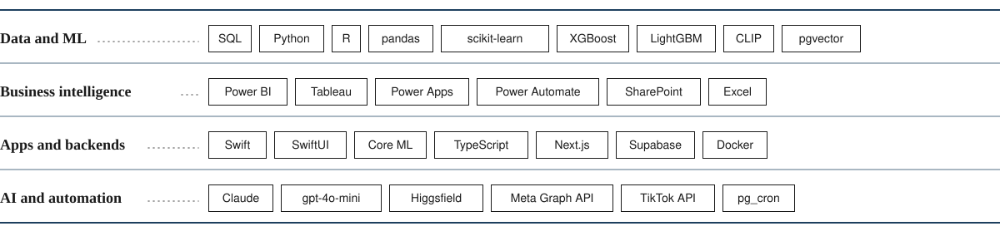

<a href="https://marcdebatlle.com"><picture><source media="(prefers-color-scheme: dark)" srcset="assets/banner-dark.svg"></picture></a>

  <a href="https://marcdebatlle.com"><b>marcdebatlle.com</b></a> ·
  <a href="https://www.linkedin.com/in/marc-de-batlle-b15172328/">LinkedIn</a> ·
  <a href="mailto:mdebatlle@gmail.com">Email</a> ·
  <a href="https://marcdebatlle.com/cv/Marc_de_Batlle_Juan_CV.pdf">CV</a> ·
  <a href="https://wrdb.site">WRDB</a>

Hey, I'm Marc. I study **Business Intelligence & Data Analytics** at La Salle BCN (4th year) and I like taking a business problem all the way to something people actually use: data, model, product.

- Co-founder & CEO of **[WRDB](https://wrdb.site)**, an AI wardrobe app for iOS, live on TestFlight. I own data, ML, analytics and growth.
- Freelance developer for real clients: CRMs, a speech-data platform for the BSC, technical specs.
- Looking for an **internship in data or AI**.

## Projects

| Project | Description | Result |
| :-- | :-- | --: |
| 👕 **[WRDB](https://marcdebatlle.com/work/wrdb)** | AI virtual wardrobe for iOS: snap your clothes, get outfits from what you own | **2,129** garments |
| 📣 **[Marketing machine](https://marcdebatlle.com/work/marketing-machine)** | Supabase edge functions that plan, render, post and measure WRDB's content with no human in the loop | **491** posts, 15 € total |
| 🛍️ **[Affiliate marketplace](https://marcdebatlle.com/work/affiliate-marketplace)** | Awin feeds, CLIP vectors in pgvector and a scoring engine for recommendations | **14,274** → 298 products |
| ⚡ **[BuildLoud](https://marcdebatlle.com/work/buildloud)** | The marketing machine turned into a multi-tenant product at a hackathon | **48 h** to live |
| 🧾 **[Renda 2025 CRM](https://marcdebatlle.com/work/tax-manager)** | Power Apps + Power Automate CRM that ran a tax advisory's whole season | **250+** clients |
| 🎙️ **[Donants de Veu](https://marcdebatlle.com/work/common-voice)** | Mozilla Common Voice rebuilt to collect non-normative Catalan speech for the BSC | **80** speakers |
| 🎟️ **[ARA Cultura](https://marcdebatlle.com/work/ara-cultura)** | Spec for a CRM-integrated members' area and booking flow | **9** screens |
| 🎯 **[Valorant Predictor](https://github.com/wyndollin/Valorant-Predictor-v2)** | Ensemble of RF, XGBoost and LightGBM blended with a neural net | **180+** features |
| 📈 **[Polymarket bot](https://github.com/wyndollin/Polymarket)** | Volatility straddle on 50/50 esports markets instead of picking winners | **94.2%** backtest win rate |
| 🕷️ **[VLR.gg Scraper](https://github.com/wyndollin/vlr.gg-scraper)** | CLI scraper that turns VLR.gg matches into map-level CSV / Excel datasets | **1** row per map |

## Stack

<picture><source media="(prefers-color-scheme: dark)" srcset="assets/stack-dark.svg"></picture>

`SQL` `pandas` `XGBoost` `LightGBM` `Core ML` `SwiftUI` `CLIP` `pgvector` `Power BI` `Tableau` `Power Platform` `LLM APIs`

## Outside of code

🎹 Piano &nbsp;·&nbsp; 🧗 Climbing &nbsp;·&nbsp; 🎮 Valorant esports, which is where the predictor and the scraper came from
