<a href="https://marcdebatlle.com"><picture><source media="(prefers-color-scheme: dark)" srcset="assets/banner-dark.svg"></picture></a>

  <a href="https://marcdebatlle.com"><b>marcdebatlle.com</b></a> &nbsp;·&nbsp;
  <a href="https://www.linkedin.com/in/marc-de-batlle-b15172328/">LinkedIn</a> &nbsp;·&nbsp;
  <a href="mailto:mdebatlle@gmail.com">mdebatlle@gmail.com</a> &nbsp;·&nbsp;
  <a href="https://marcdebatlle.com/cv/Marc_de_Batlle_Juan_CV.pdf">CV</a> &nbsp;·&nbsp;
  <a href="https://wrdb.site">wrdb.site</a>

Fourth-year **Business Intelligence & Data Analytics** student at La Salle BCN with a hybrid profile: I understand the business problem, translate it into a technical solution, and ship it. Not the analyst who hands over a slide and walks away, and not the developer who never asks why.

I am co-founder and CEO of **WRDB**, an AI wardrobe app on TestFlight, where I own data, ML, analytics and growth. Freelance, I have shipped a CRM that ran a full tax season for a 250-client advisory and a speech platform collecting non-normative Catalan for the BSC. I am looking for an **internship in data or AI**.

<picture><source media="(prefers-color-scheme: dark)" srcset="assets/head-part1-dark.svg"></picture>

<table>
<tr><td width="50%"><a href="https://marcdebatlle.com/work/wrdb"><picture><source media="(prefers-color-scheme: dark)" srcset="assets/card-wrdb-dark.svg">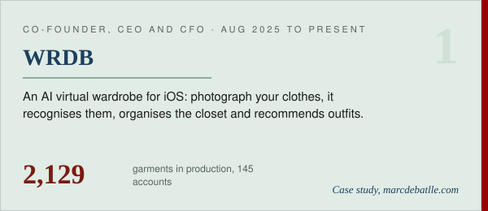</picture></a></td><td width="50%"><a href="https://marcdebatlle.com/work/marketing-machine"><picture><source media="(prefers-color-scheme: dark)" srcset="assets/card-marketing-machine-dark.svg">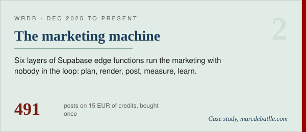</picture></a></td></tr>
<tr><td width="50%"><a href="https://marcdebatlle.com/work/affiliate-marketplace"><picture><source media="(prefers-color-scheme: dark)" srcset="assets/card-affiliate-marketplace-dark.svg">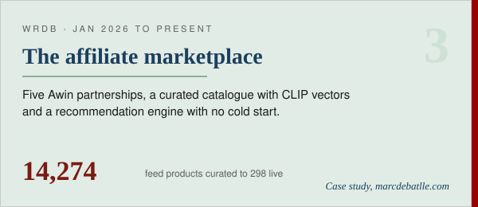</picture></a></td><td width="50%"><a href="https://marcdebatlle.com/work/buildloud"><picture><source media="(prefers-color-scheme: dark)" srcset="assets/card-buildloud-dark.svg">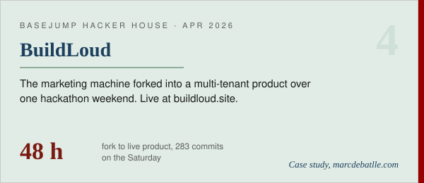</picture></a></td></tr>
</table>

<picture><source media="(prefers-color-scheme: dark)" srcset="assets/head-part2-dark.svg"></picture>

<table>
<tr><td width="50%"><a href="https://marcdebatlle.com/work/tax-manager"><picture><source media="(prefers-color-scheme: dark)" srcset="assets/card-tax-manager-dark.svg"></picture></a></td><td width="50%"><a href="https://marcdebatlle.com/work/common-voice"><picture><source media="(prefers-color-scheme: dark)" srcset="assets/card-common-voice-dark.svg">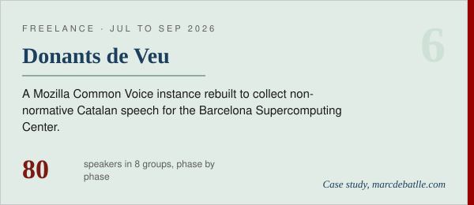</picture></a></td></tr>
<tr><td width="50%"><a href="https://marcdebatlle.com/work/ara-cultura"><picture><source media="(prefers-color-scheme: dark)" srcset="assets/card-ara-cultura-dark.svg">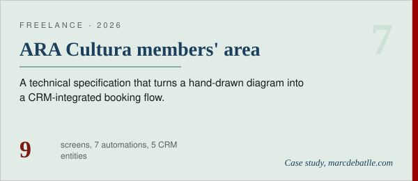</picture></a></td><td width="50%"><picture><source media="(prefers-color-scheme: dark)" srcset="assets/note-clients-dark.svg">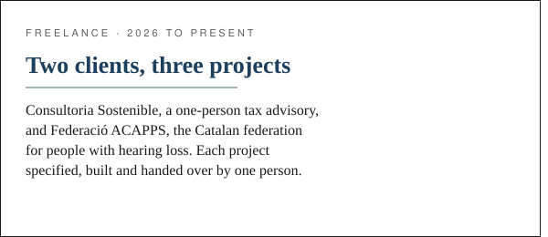</picture></td></tr>
</table>

<picture><source media="(prefers-color-scheme: dark)" srcset="assets/head-part3-dark.svg"></picture>

<table>
<tr><td width="50%"><a href="https://github.com/wyndollin/Valorant-Predictor-v2"><picture><source media="(prefers-color-scheme: dark)" srcset="assets/card-valorant-predictor-dark.svg">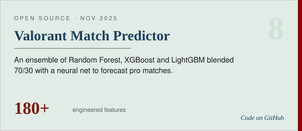</picture></a></td><td width="50%"><a href="https://github.com/wyndollin/Polymarket"><picture><source media="(prefers-color-scheme: dark)" srcset="assets/card-polymarket-dark.svg">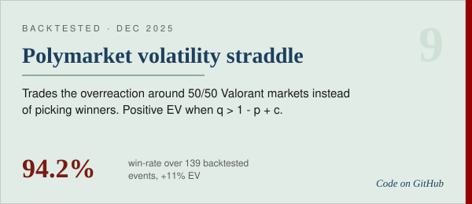</picture></a></td></tr>
<tr><td width="50%"><a href="https://github.com/wyndollin/vlr.gg-scraper"><picture><source media="(prefers-color-scheme: dark)" srcset="assets/card-vlr-scraper-dark.svg">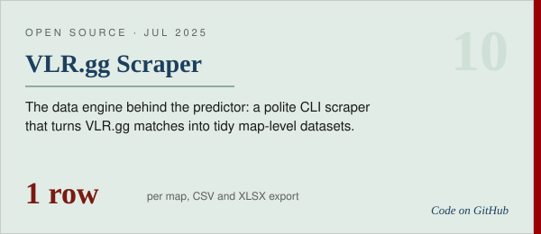</picture></a></td><td width="50%"><a href="https://github.com/wyndollin?tab=repositories"><picture><source media="(prefers-color-scheme: dark)" srcset="assets/note-models-dark.svg">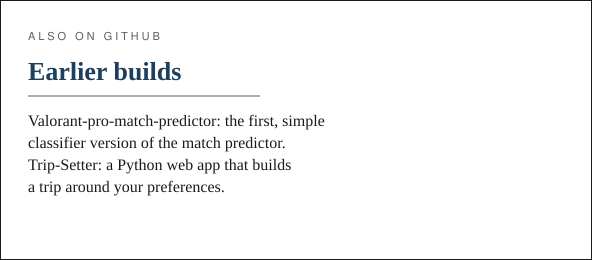</picture></a></td></tr>
</table>

Each card opens its case study on marcdebatlle.com, or the repository where the code is public.

### The path

| When | What |
| :-- | :-- |
| 2026 to present | **Freelance developer**, business and AI solutions for real clients |
| Aug 2025 to present | **Co-founder & CEO, WRDB**, AI virtual wardrobe for iOS, in beta on TestFlight |
| Apr 2026 | **BuildLoud**, built in 48 h at Basejump Hacker House, backed by V3V Ventures and Lost Astronaut |
| Jan to Apr 2026 | **Volunteer**, Fundació Comtal's Sant Jordi 2026 campaign |
| Jun 2025 | **Machine Learning & BI course**, UESTC, Chengdu, China |
| Oct 2024 to Feb 2025 | **Co-founder, DHM Middleman**, client acquisition and sales for small businesses |
| 2023 to Jul 2027 | **BSc Business Intelligence & Data Analytics**, La Salle BCN |

<picture><source media="(prefers-color-scheme: dark)" srcset="assets/head-stack-dark.svg"></picture>

<picture><source media="(prefers-color-scheme: dark)" srcset="assets/stack-dark.svg"></picture>

<b>Appendix B. Numbers from GitHub</b>

 

  <picture><source media="(prefers-color-scheme: dark)" srcset="https://github-readme-stats.vercel.app/api?username=wyndollin&show_icons=true&hide_border=true&include_all_commits=true&count_private=true&title_color=9cc3e6&icon_color=e38a7f&text_color=e6ede8&bg_color=14201a"></picture>
  &nbsp;
  <picture><source media="(prefers-color-scheme: dark)" srcset="https://github-readme-stats.vercel.app/api/top-langs/?username=wyndollin&layout=compact&hide_border=true&langs_count=8&hide=html,css,jupyter%20notebook&title_color=9cc3e6&icon_color=e38a7f&text_color=e6ede8&bg_color=14201a"></picture>

 

<picture><source media="(prefers-color-scheme: dark)" srcset="assets/footer-dark.svg"></picture>
